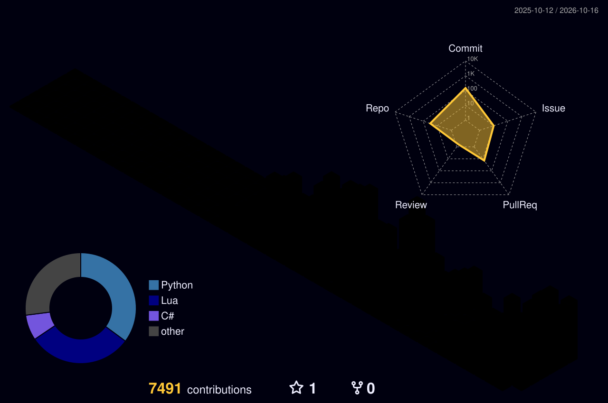

I build **local-first AI developer tools**, **game-streaming infrastructure**, **game mods**, and
**reverse-engineering research tooling**, shipped under [**Kuno Labs**](https://github.com/kunolabs) and here.
Most of my work is private while it is being built; the public pieces below are the ones that have real users.

<p>
  <a href="https://github.com/kunolabs/yukistreams-addon"></a>
  <a href="https://github.com/kunolabs/codeprism"></a>
  <a href="https://github.com/kunolabs/Nimbus"></a>
  <a href="https://github.com/ywkuno/godot-mcp-agents"></a>
  
  
  <a href="https://ko-fi.com/kunolabs"></a>
</p>

## Featured

<table>
  <tr>
    <td width="50%" valign="top">
      <h3><a href="https://github.com/kunolabs/yukistreams-addon">🌸 YukiStreams</a></h3>
      <p>Stremio addon for anime, Asian drama, movies, and series, with optional Real-Debrid and TorBox
      support. The most-used thing I ship: a public instance, real users, real uptime expectations.</p>
      <p><a href="https://stremio.yukistreams.xyz/configure">stremio.yukistreams.xyz</a></p>
    </td>
    <td width="50%" valign="top">
      <h3><a href="https://github.com/kunolabs/codeprism">🔍 CodePrism</a></h3>
      <p>Local-first context for AI coding agents: <em>map first, slice next, retrieve exactly.</em> Turns a
      repository into an inspectable graph before an assistant reads the whole tree; exports Markdown, JSON,
      DOT, SQLite, and a static browser viewer. Ships Claude Code hooks and a skill.</p>
    </td>
  </tr>
  <tr>
    <td width="50%" valign="top">
      <h3><a href="https://github.com/kunolabs/Nimbus">☁️ Nimbus</a></h3>
      <p>Community-maintained game-streaming <strong>host</strong> fork in the Vibepollo → Apollo → Sunshine
      lineage. Virtual display reliability, Windows capture behaviour, frame pacing, Android TV compatibility,
      and honest release hygiene, for people who actually stream from a gaming PC.</p>
    </td>
    <td width="50%" valign="top">
      <h3><a href="https://github.com/ywkuno/godot-mcp-agents">🎮 Godot MCP Agents</a></h3>
      <p>An MCP server that gives Claude Code and other agents control of Godot 4.x: 158 tools across headless
      scene operations, runtime introspection, gameplay debugging and a live TCP bridge, with
      <strong>tier-aware tool budgets</strong> (<code>full</code> / <code>lite</code> / <code>minimal</code>)
      so the surface fits any client's tool limit.</p>
    </td>
  </tr>
</table>

```bash
# CodePrism in three lines
codeprism prime "what I am changing" --changed
codeprism query "where does this behavior live?"
codeprism visualize
```

## In the Lab (private while it is being built)

- 🔱 **Trinity**: a supervisor-to-worker delegation runtime. Frontier orchestrators (Claude Code, Codex) hand
  bounded tasks to persistent DeepSeek workers over MCP/ACP, inside Windows AppContainer sandboxes, with host
  receipts and gated evidence instead of worker claims.
- 📱 **DSH Remote**: phone remote control for DeepSeek Harness sessions over Tailscale.
- 🧪 **Reverse-engineering research**: GraalVM native-image symbol recovery, packet-structure scoping, and game
  preservation tooling, kept private and read-only by design.

## Also on the Bench

- 🛠️ [baro-hud-vitals](https://github.com/ywkuno/baro-hud-vitals): Barotrauma crew vitals HUD (LuaCs, Workshop).
- 🤖 [baro-crew-tweaks](https://github.com/ywkuno/baro-crew-tweaks): Barotrauma bot behaviour fixes, published as *Smarter Bot AI - Patched2K*.
- 🔫 [rangecrafting](https://github.com/ywkuno/rangecrafting): 7 Days to Die crafting-only linked inventory (C# ModAPI).
- 🐢 [node](https://github.com/ywkuno/node): Node.js fork carrying libuv 1.53 / AppContainer pipe research branches.
- 🕹️ Godot prototypes and cozy games, driven by the MCP server above.

## What I Am Building Toward

- Local-first AI tooling that works before it talks to the network.
- Codebase maps, slices, receipts and replay artifacts that make agent work inspectable.
- Streaming projects with honest release notes and reproducible builds.
- Desktop tools that are practical for non-technical users.
- Game and mod utilities that favour readability, stability, and fast iteration.

## Stack I Reach For

<p align="center">
  <a href="https://skillicons.dev">
    
  </a>
</p>

## Operating Principles

> Map first, then read.<br>
> Keep useful artifacts inspectable.<br>
> Prefer deterministic parsing before heavy magic.<br>
> Measure before making performance or token-saving claims.<br>
> Worker claims are not evidence; receipts are.<br>
> Make public maintenance boring, transparent, and repeatable.<br>
> Build tools that stay useful when the network is off.

## Activity

<p align="center">
  <picture>
    <source media="(prefers-color-scheme: dark)" srcset="./profile-3d-contrib/profile-night-rainbow.svg" />
    <source media="(prefers-color-scheme: light)" srcset="./profile-3d-contrib/profile-gitblock.svg" />
    
  </picture>
</p>

<p align="center">
  
</p>
<p align="center">
  
  
</p>


